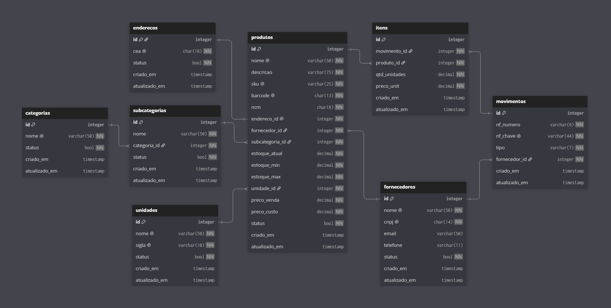

<h1 align="center">API WMS</h1>

<p align="center">
  API REST em Python para gestão de armazéns (WMS) e rastreabilidade de estoques
  <br><br>
  
  
  
  
  
</p>

---

### 📖 Sobre o Projeto

A **API WMS** (Warehouse Management System) é um sistema back-end desenvolvido para centralizar, organizar e auditar a gestão de estoques. Construída com base na minha experiência prática na área de Logística, a aplicação modela a realidade operacional de um armazém físico. Ela garante a rastreabilidade de todas as movimentações (entradas e saídas), além de gerenciar fornecedores, categorias, unidades e o endereçamento dos produtos.

**⚠️ Nota sobre o Escopo (Projeto de Portfólio)**
Este é um case fictício desenvolvido especificamente para fins de portfólio. Embora a arquitetura tenha sido construída rigorosamente sobre as melhores práticas de engenharia de software do mercado, o escopo de negócio foi intencionalmente simplificado.

O objetivo principal do projeto é demonstrar domínio técnico, organização e qualidade de código. Portanto, ele não tem a pretensão de cobrir exaustivamente todas as particularidades, integrações e fluxos complexos que um WMS comercial de grande porte exigiria na vida real.

---

### 🖥️ Tecnologias Utilizadas

- **Linguagem**: `Python 3.11+`
- **Bibliotecas Principais**: `FastAPI`, `Pydantic`, `SQLAlchemy`, `Uvicorn`

---

### ⚡ Principais Funcionalidades

- 📦 **`Catálogo de Produtos`**: Endpoints para controle completo de itens, categorias e unidades de medida.
- 🔄 **`Movimentações de Estoque`**: Registro rigoroso de transações de Entrada e Saída, rastreadas de ponta a ponta pela **Chave de Acesso da Nota Fiscal**.
- 📍 **`Gestão de Armazenagem`**: Endpoints para administração e mapeamento exato dos locais físicos no armazém.
- 🤝 **`Gestão de Fornecedores`**: Endpoints para cadastro e manutenção dos parceiros comerciais atrelados às entradas e saídas de mercadorias.
- 📊 **`Consultas e Resumos`**: Endpoints otimizados para listagens, aplicação de filtros e extração do histórico e saldo do inventário.

---

### ⚠️ Pré-requisitos

1. **Python 3.11+**
2. *(Opcional)* Um banco de dados relacional como **PostgreSQL** ou **MySQL**, caso deseje rodar a aplicação fora do ambiente **SQLite** padrão.

---

### 🛠️ Instalação e Ambiente

> **💡 Dica:** É altamente recomendado utilizar um ambiente virtual (`venv`) para isolar as dependências do projeto.

1. Clone o repositório e acesse a pasta do projeto:

    ```bash
    git clone https://github.com/andrellmagalhaes/api-wms.git
    cd api-wms
    ```

2. Crie o ambiente virtual:

    - **No Windows:**
    ```cmd
    python -m venv venv
    ```

    - **No Linux:**
    ```bash
    python3 -m venv venv
    ```

3. Ative o ambiente virtual:

    - **No Windows:**
    ```cmd
    venv\Scripts\activate
    ```

    - **No Linux:**
    ```bash
    source venv/bin/activate
    ```

4. Configure as variáveis de ambiente:

    Crie uma cópia do arquivo de exemplo para o seu ambiente local:

    - **No Windows:**
    ```cmd
    copy .env.example .env
    ```

    - **No Linux:**
    ```bash
    cp .env.example .env
    ```
    *(Opcional: abra o arquivo `.env` gerado e edite a variável `DATABASE_URL` caso decida não utilizar o SQLite padrão).*

5. Instale o projeto localmente:

    - **Instalação padrão (utiliza SQLite):**
    ```bash
    pip install .
    ```

    - **Instalação para desenvolvimento (inclui testes e linting):**
    ```bash
    pip install ".[dev]"
    ```

    - **Instalação para desenvolvimento com dados fictícios (inclui testes, linting e o script de seed):**
    ```bash
    pip install ".[dev,seed]"
    ```

    - **Instalação para produção (exemplo ativando driver do PostgreSQL):**
    ```bash
    pip install ".[postgres]"
    ```

---

### 🔬 Testes

#### Executando os testes

1. Instale o projeto com as dependências de desenvolvimento:
```bash
pip install -e ".[dev]"
```

2. Execute os testes:
```bash
pytest
```

3. Para executar os testes exibindo a cobertura:
```bash
pytest --cov
```

---

### 🎲 Banco de Dados e Modelagem

**Arquitetura Agnóstica**

A API foi desenvolvida sem um banco de dados acoplado. Graças ao uso do **SQLAlchemy 2.0**, você tem total liberdade para escolher qual banco relacional utilizar, sem precisar alterar nenhuma linha de código da aplicação. A string de conexão é configurada facilmente via `.env` (veja o `.env.example`).

Para manter o ambiente limpo, os drivers não vêm instalados por padrão:
- **Testes/Desenvolvimento:** O SQLite funciona "fora da caixa", ideal para rodar o projeto rapidamente.
- **Produção:** Instale apenas o driver do banco escolhido (como PostgreSQL ou MySQL) como dependência opcional (ex: utilizando as *flags* configuradas no `pyproject.toml`).

**Diagrama Entidade-Relacionamento (DER)**

Para facilitar a compreensão das regras de negócio e do domínio da aplicação, a estrutura das tabelas foi modelada antes do desenvolvimento. Abaixo está a representação visual da arquitetura de dados:



> 💡 **Nota:** O código-fonte da modelagem (`schema.dbml`) está guardado na pasta `docs/database/`. Você pode copiá-lo e colá-lo no [dbdiagram.io](https://dbdiagram.io) para visualizar ou editar as relações interativamente.

---

### 📌 Instruções de Uso

Com os pré-requisitos configurados, a instalação concluída e o ambiente virtual ativado, a aplicação estará pronta para ser iniciada.

Para rodar o servidor em modo de desenvolvimento (que reinicia automaticamente ao detectar mudanças no código), execute no terminal:

```bash
uvicorn src.main:app --reload
```

*(Nota: O servidor será iniciado na porta 8000. Caso decida rodar a API em uma porta diferente, lembre-se de usar a mesma porta para acessar a documentação e ao executar o script de seed).*

Como se trata de uma API REST, o FastAPI gera automaticamente uma interface visual completa para explorar e interagir com as rotas.

Com o servidor rodando, abra o seu navegador e acesse a documentação:

- **Swagger UI (Interativo):** http://127.0.0.1:8000/docs
- **ReDoc (Leitura):** http://127.0.0.1:8000/redoc

---

### 🌱 Populando o Banco de Dados (Seed)

Para facilitar os testes e a exploração da API, o projeto conta com uma pasta `sample_data/` que contém arquivos JSON com dados fictícios gerados via IA.

A pasta também inclui um script Python (`seed.py`) que automatiza o processo de popular o banco de dados. Em vez de inserir os dados diretamente no banco, o script faz requisições `POST` nas rotas da API. Isso garante que os dados de teste passem por todas as regras de negócio e validações reais da aplicação.

### 🚀 Como executar o Seed

1. Certifique-se de que a sua API já esteja rodando localmente.
2. Instale as dependências opcionais necessárias para o script executando o comando abaixo na raiz do projeto:
   ```bash
   pip install ".[seed]"
   ```
3. Com a dependência instalada, execute o script:
   ```bash
   python sample_data/seed.py
   ```

> 💡 **Nota:** O script aponta para a porta **8000** por padrão. Se você iniciou a API em uma porta diferente, abra o arquivo `sample_data/seed.py` e ajuste a porta manualmente antes de executar.

---

### 🔗 Principais Rotas

Abaixo estão listados alguns dos principais endpoints disponíveis para a integração e gestão dos recursos do sistema. A API segue os padrões REST, permitindo a consulta e manipulação das entidades essenciais para o funcionamento da aplicação.

| Método | Endpoint | Descrição |
| :--- | :--- | :--- |
| `GET` | `/produtos` | Lista todos os produtos disponíveis. |
| `POST` | `/produtos` | Cadastra um novo produto. |
| `GET` | `/fornecedores` | Lista todos os fornecedores parceiros. |
| `POST` | `/fornecedores` | Cadastra um novo fornecedor. |
| `GET` | `/movimentos` | Consulta o histórico de movimentações (como entradas e saídas). |
| `POST` | `/movimentos` | Registra uma nova movimentação no sistema. |

> **Dica:** Você pode usar ferramentas como [Postman](https://www.postman.com/) para testar as requisições acima.

---

### 🗺️ Roadmap e Próximos Passos

Atualmente, o projeto encontra-se na versão **1.0.0**. As próximas evoluções mapeadas para a API incluem:

- [ ] **Módulo de Separação (Picking):** Implementar o gerenciamento de listas de separação para saídas de mercadorias, vinculando produtos (via ID) para identificar automaticamente o endereço de armazenagem e o fornecedor (cliente) de destino.
- [ ] **Segurança e Autenticação (OAuth2/JWT):** Proteger os endpoints da API garantindo que apenas usuários autorizados possam realizar operações de alteração de dados (DML).
- [ ] **Auditoria (Logs):** Criar um middleware global para registrar requisições, monitorar erros e rastrear a autoria das operações em conjunto com a autenticação.
- [ ] **Conteinerização (Docker):** Empacotar a aplicação e suas dependências utilizando `Dockerfile` e `docker-compose`, padronizando o ambiente de execução e preparando a API para futuros deploys em nuvem.
